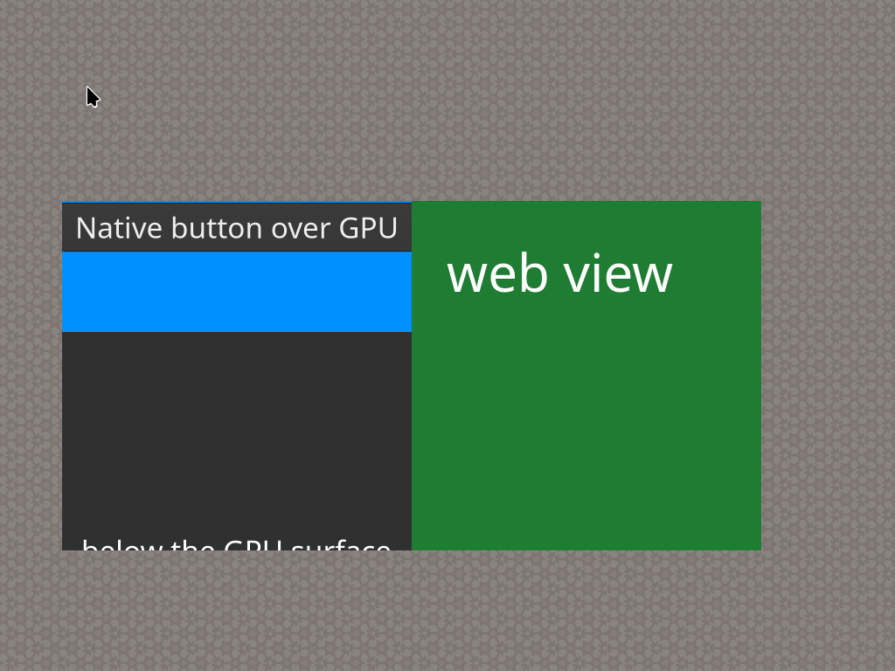

# The GTK4 gate: a WebGPU surface inside a GTK window

Recorded 2026-11-18 on FRACTAL-NORTH (Ryzen 9 7950X, RTX 4090, NVIDIA 615.78,
NixOS), at btrc `2f886024`. This is the gate of
[native-ui-surfaces-and-hosts.md](../native-ui-surfaces-and-hosts.md),
section 3, and it decides plan decision D23.

**Result: route 1 passes. Linux moves to GTK4.**

## What was asked

Before any provider work, one GTK4 window had to show a WebGPU surface with a
native button above it, inside a scroll view, beside a web view, and hold the
display's refresh rate. The earlier plain-C spike
([linux-gtk4-feasibility.md](../linux-gtk4-feasibility.md)) had found only CPU
readback to compose correctly.

## Route 1: a subsurface below a transparent window

`gate.c` is the whole spike, about 230 lines of C:

- The GTK toplevel's background is transparent, and every widget that should
  be opaque paints its own background. Where the GPU surface shows, GTK paints
  nothing: a hole.
- The GPU surface is a `wl_subsurface` of the toplevel's `wl_surface`, placed
  **below** it, in desync mode, with an empty input region so the pointer goes
  to GTK. wgpu-native renders to it as to any Wayland surface.
- Each frame, from a GTK tick callback, the subsurface is moved to the hole's
  bounds on the toplevel (`gtk_widget_compute_bounds`, plus the surface
  transform) and cropped to the scrolled window through `wp_viewport`, so the
  surface scrolls and clips with its widget.
- The Wayland globals it needs (`wl_compositor`, `wl_subcompositor`,
  `wp_viewporter`) are bound on a private event queue, so nothing of GTK's is
  dispatched from under it.

Because the surface is below the window, anything GTK draws over the hole is
above it: a native button, a popover, a web view. That is what an X11 child
window could not do.



The screenshot is headless Weston's, taken after the content was scrolled by
150 points: the blue GPU surface is cut off at the scroll view's top edge, the
native button is drawn over it, the label below it follows, and the WebKit web
view sits beside.

## Timings

Thirty seconds at a 60 Hz headless output, after one second of start-up
(1,799 intervals between GTK frame ticks). A missed frame is an interval over
25 ms.

| Path | Compositor | GPU surface | p50 | p95 | p99 | max | Missed |
| --- | --- | --- | ---: | ---: | ---: | ---: | ---: |
| Software | Weston, pixman | lavapipe | 16.67 ms | 16.91 ms | 17.02 ms | 17.72 ms | 0 |
| Hardware | Weston, GL on NVIDIA EGL | RTX 4090, Vulkan | 16.66 ms | 17.02 ms | 17.34 ms | 17.81 ms | 0 |

Both hold the refresh rate: every frame arrived within its interval. Under
load (a parallel test run compiling beside it) the hardware path missed 0 to 1
frame of 1,799 and the software path 0 to 2.

The plan asked for "frame p95 of 16.7 ms or better". Intervals at 60 Hz centre
on 16.67 ms, so that wording could only be met with no jitter at all; what it
meant, and what is recorded, is that no frame is missed.

## What this does not show

- **The real display.** The desktop session was locked, so nothing was run on
  KWin and the XDR. The hardware path exercised the same pieces a real session
  uses (NVIDIA's Vulkan Wayland presentation, a GL compositor, dmabuf
  buffers), on a headless output.
- **A btrc-hosted window.** The spike is C. The provider is planned as a C
  shim that owns the GTK objects and queues their signals as events BTRC
  polls each turn, as the SDL provider does, so it needs no callbacks into
  BTRC and no GObject binding. The first provider commit must show that: a
  BTRC program opening this window through the shim. **Shown since:**
  `hosted-window.png` is headless Weston's screenshot of
  `examples/gui/Native.btrc` built on the provider in `GUI/Linux/Gtk`, whose
  shim (`GtkShim.c`) places the provider's surface below a `GtkWindow`.
- **X11.** Not run here. The plan stands: a child window when nothing
  overlaps the GPU surface, readback when something does. The provider's
  child window has since passed the conformance suite under Xvfb.
- **Input over the surface.** The empty input region is set; no pointer was
  sent through it.

## Reproducing it

```sh
nix develop --impure -f docs/design/native-ui-gtk4-gate/shell.nix --command sh -c '
  docs/design/native-ui-gtk4-gate/build.sh &&
  docs/design/native-ui-gtk4-gate/run.sh &&
  RENDERER=gl docs/design/native-ui-gtk4-gate/run.sh'
```

`shell.nix` is the dev shell plus WebKitGTK 6.0, the Wayland scanner and
protocols and Weston's screenshot client, none of which the dev shell carries
yet. Everything is written under `build/gtk4-gate`. `run.sh` prints the
adapter and the timings and leaves `wayland-screenshot-*.png` there; with
`RENDERER=gl` Weston's own screenshot comes out upside down.

This directory goes when the GTK provider's GPU view lands and the conformance
suite's cases hold the same ground.
